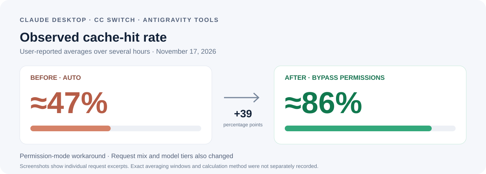
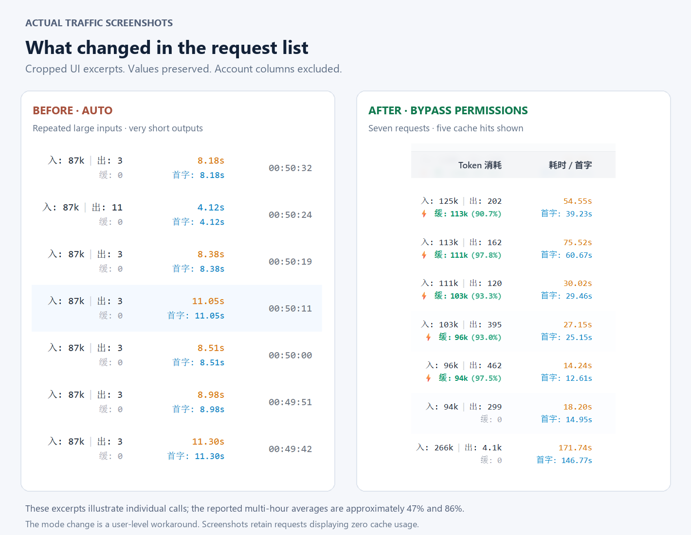
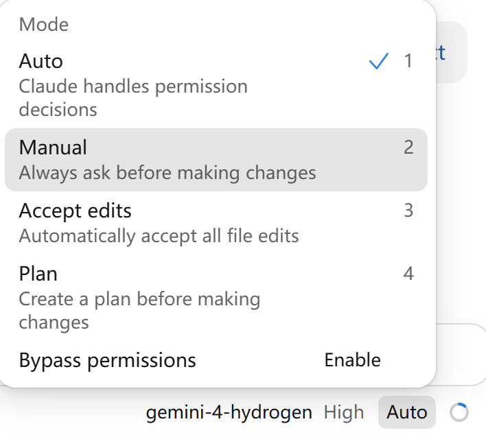

# A permission-mode and cache-hit case study in Claude Desktop

[中文](README.md)

I use Gemini in Claude Desktop through **CC Switch → Antigravity Tools → the Antigravity upstream**. During long tasks, the traffic monitor showed many consecutive requests with large inputs, often only three output tokens, and repeated identical input-token counts.

After I changed the permission mode from **Auto** to **Bypass Permissions**, the original symptom disappeared in this run. Over several hours, my observed average cache-hit rate rose from **approximately 47% to approximately 86%**, an increase of **39 percentage points**.

**The percentages are approximate multi-hour observations reported by the user. The screenshots below are illustrative request excerpts. Individual request ratios and multi-hour averages measure different things.**

## What the traffic looked like

The left excerpt comes from the original Antigravity Tools screenshot. It shows repeated large input counts, very short outputs, and cache usage displayed as zero. The right screenshot shows seven post-change requests. Five display cache reuse between 90.7% and 97.8%, while two requests displaying zero cache usage remain visible too.

The published images show token usage, cache usage and latency summaries. Numerical values were preserved. Account information and unrelated content are outside the images.

Original-resolution crops: [before](assets/traffic-before.png) · [after](assets/traffic-after.png).

## Environment

| Component | Observed setup |
| --- | --- |
| Client | Claude Desktop, bundled Claude Code 2.1.325 recorded during diagnosis |
| Configuration and local forwarding | CC Switch 4.0.33 |
| Proxy | Antigravity Tools 5.0.3 |
| Requested model | `gemini-4-hydrogen` |
| Observation date | November 17, 2026, UTC+8 |
| Change | Claude Desktop permission mode, Auto → Bypass Permissions |

The earlier short-output requests used the LOW tier. The later successful requests mainly used HIGH. These panels show the observed change in request composition. Exact boundaries and the calculation method for the multi-hour averages were not saved separately; 47% and 86% are retained as the user's approximate observations.

## What I changed

I switched the permission mode from Auto to Bypass Permissions, continued the task, and watched the traffic monitor.

The menu screenshot was captured before the change and still shows Auto selected. Completion of the switch and its effects are reported from the user's experience.

**Bypass Permissions skips most permission approvals. This is the workaround I chose for my own run. Users who want to retain approval prompts can first try Manual or Accept edits and inspect their traffic again.** See the [official permission-mode documentation](https://code.claude.com/docs/en/permission-modes).

## Interpretation

The earlier diagnosis identified many background safety-classification requests. The change in that traffic after switching modes is consistent with the disappearance of the symptom. A plausible explanation is that fewer classification calls increased the share of normal long-task requests and the cache reuse visible in the aggregate statistics.

The observation applies to this particular client, proxy, and model combination. The mode change coincided with the disappearance of repeated short-output requests and an increase in the observed average cache-hit rate. A developer reproduction with identical inputs and model tiers would clarify the contribution of gateway parameter mapping and other factors. This report describes a user-level workaround; no gateway code was changed.

Related background: [Antigravity Tools #3693](https://github.com/lbjlaq/Antigravity-Manager/issues/3693) and [CC Switch #7721](https://github.com/farion1231/cc-switch/issues/7721). They discuss empty-response handling and auto-mode compatibility under their own reproduction conditions.

## Published evidence

This repository contains actual UI crops, the approximate comparison graphic, and a compact [evidence summary](evidence-summary.json). Request and response bodies, transcripts, authentication fields, account emails, and raw log databases are excluded. The comparison graphic labels 47% and 86% as user-reported values.
