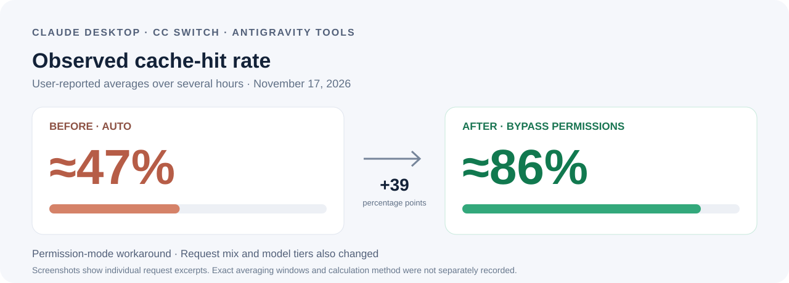
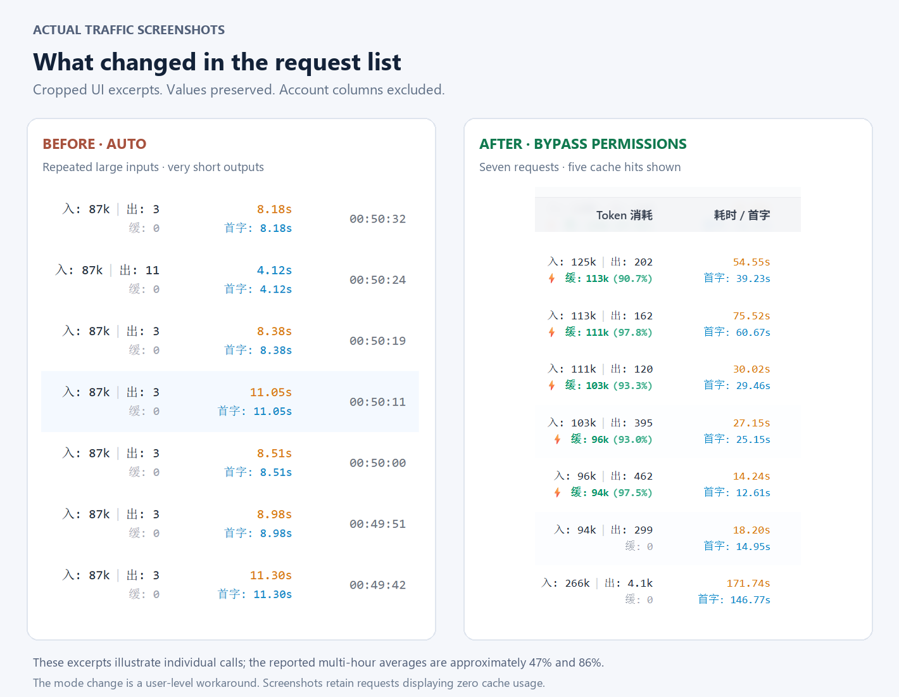
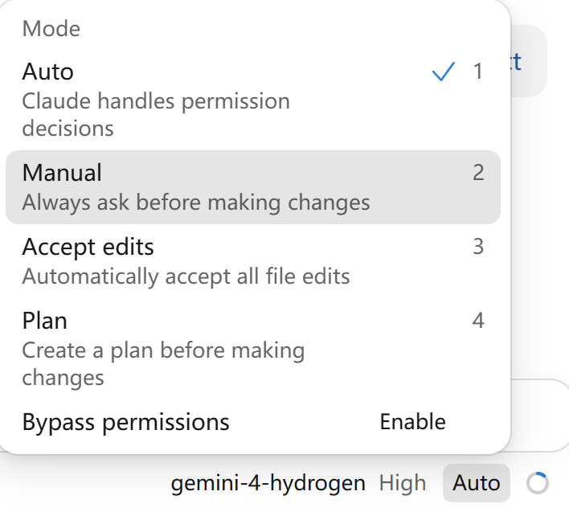

# Claude Desktop 权限模式与缓存命中率的一次实际对比

[English](README.en.md)

我通过 **CC Switch → Antigravity Tools → Antigravity 上游模型** 在 Claude Desktop 中使用 Gemini。在长任务运行期间，流量日志出现大量连续请求，每次携带很大的输入，输出常常只有 3 token，输入量还会连续多次保持相同。

我将审批模式从 **Auto** 切换为 **Bypass Permissions** 后，原先的问题在这次使用中消失。数小时内观察到的平均缓存命中率从 **约 47% 上升到约 86%**，提高 **39 个百分点**。

**47% 和 86% 是本人在数小时使用中观察到的约数。下面的截图展示典型请求片段，单条请求的缓存比例与数小时平均值含义不同。**

## 先看流量截图

左侧来自最初发现问题时的 Antigravity Tools 流量截图。能看到连续相同的大输入、3 token 左右的短输出，以及界面显示的“缓 0”。右侧来自切换后的真实流量截图，七条请求中，五条显示 90.7% 至 97.8% 的缓存复用，同时保留了两条缓存显示为 0 的请求。

公开图片仅展示 token、缓存和耗时等摘要。数值没有重写，账号和其他无关信息未出现在图片中。

原尺寸裁剪图可单独查看：[切换前](assets/traffic-before.png) · [切换后](assets/traffic-after.png)。

## 使用环境

| 项目 | 本次环境 |
| --- | --- |
| 客户端 | Claude Desktop，内嵌 Claude Code 2.1.325，排查时记录 |
| 配置与本地转发 | CC Switch 4.0.33 |
| 反代 | Antigravity Tools 5.0.3 |
| 请求模型 | `gemini-4-hydrogen` |
| 观察日期 | 2026 年 11 月 17 日，UTC+8 |
| 调整项 | Claude Desktop 的审批模式，Auto → Bypass Permissions |

截图对应的前期短输出请求使用 LOW 档位，后期成功请求主要使用 HIGH 档位。这组图片展示的是实际请求构成的变化。完整数小时窗口的起止时间和统计计算方式没有单独保存，47% 与 86% 以本人的约数观察记录。

## 我做了什么

在 Claude Desktop 的权限模式菜单中，我从 Auto 切换到 Bypass Permissions，然后继续运行任务并观察 Antigravity Tools 的流量。

这张菜单截图拍摄于操作前，Auto 仍带有选中标记。切换完成及其后续效果由本人使用观察记录。

**Bypass Permissions 会跳过大部分权限审批。本文记录本人选择的临时规避方式。希望保留审批的用户，可以优先尝试 Manual 或 Accept edits，并重新核对流量。** [Claude 官方权限模式说明](https://code.claude.com/docs/en/permission-modes)

## 目前的理解

前期排查已识别到大量后台安全审查调用。切换到 Bypass Permissions 后，这类审查流量的变化与本次症状消失相吻合。一个合理解释是，审批调用减少后，长任务的正常请求在整体流量中占比上升，也让统计中可见的缓存复用提高。

本案例支持的结论是，在我的这套客户端、转发和模型组合中，权限模式切换与重复短输出症状消失、整体缓存命中率上升同时出现。具体的网关参数适配和各项影响，需要开发者在相同输入、相同模型档位下进一步复现。这里记录的是使用层面的规避效果，网关代码没有修改。

相关讨论供开发者定位背景：[Antigravity Tools #3693](https://github.com/lbjlaq/Antigravity-Manager/issues/3693) · [CC Switch #7721](https://github.com/farion1231/cc-switch/issues/7721)。这些讨论涉及空回复处理和自动审查兼容性，各自的复现条件与本案例有所不同。

## 公开证据范围

本项目提供真实界面的裁剪图、约数对比图，以及简短的 [证据摘要](evidence-summary.json)。项目不包含请求或响应正文、会话记录、认证字段、账号邮箱及原始日志数据库。对比图中的 47% 和 86% 标注为使用者报告值，读者可以把截图与文字说明一起理解。
